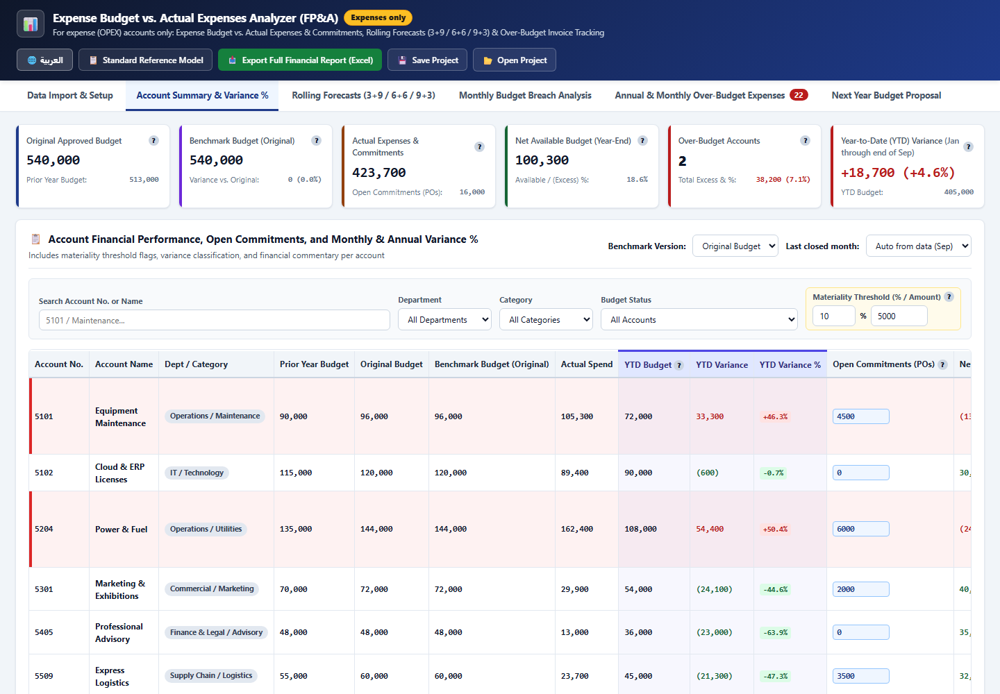
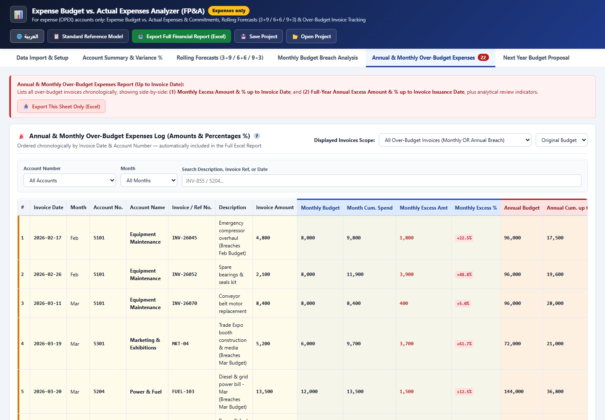
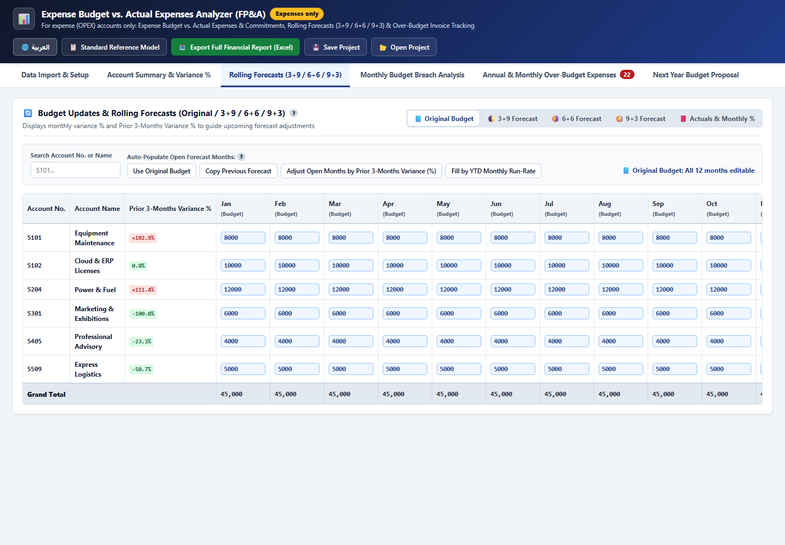

# Expense Budget vs. Actuals Analyzer — 100% Offline, No Internet Required

**FP&A tool for expense accounts: budget vs. actual expenses, rolling forecasts (3+9 / 6+6 / 9+3), invoice-level over-budget tracking and next-year budget proposals — in a single HTML file that runs entirely in your browser, with no internet, no installation and no server.**

    

> **Scope: expense (OPEX) accounts only.** Spending above budget is treated as an unfavorable overrun and spending below budget as a saving. Do not use it for revenue accounts, where exceeding budget is favorable and results would read in reverse.

[العربية ↓](#بالعربية)



---

## Why offline?

- **Your financial data never leaves your computer.** Files are read and processed inside the browser's memory. Nothing is uploaded, nothing is sent anywhere.
- **Works on locked-down corporate laptops and air-gapped machines.** No Python, no Node.js, no database, no admin rights. The Excel engine ([SheetJS Community Edition](https://sheetjs.com) v0.20.3) is embedded in the file, so reading `.xlsx`/`.xls`/`.csv` and exporting multi-sheet Excel reports work without a connection.
- **Easy to share.** Email it, put it on a USB stick or a shared drive — it is one file.

## Quick start

1. Download [`FPA_Budget_And_GL_Analyzer.html`](FPA_Budget_And_GL_Analyzer.html) (or clone this repository).
2. Double-click it. It opens in Chrome, Edge, Firefox or Safari on Windows, macOS or Linux.
3. Explore the built-in preview data, then upload your own budget and expenses from the **Data Import & Setup** tab. Ready-made templates are available from the same tab, and the files in [`samples/`](samples) can be uploaded directly.

The interface starts in **English**; switch to **Arabic** (full right-to-left layout) with the language button at any time.

## What it does

| Tab | Purpose |
|---|---|
| **Data Import & Setup** | Import an expense budget (monthly columns or one annual total) and actual expenses (a full General Ledger with dates and invoice numbers, or a monthly summary). Automatic column matching for English and Arabic headers. |
| **Account Summary & Variance %** | Per account: original budget, actual spend, open commitments (POs), net available budget, **year-to-date (YTD) variance**, **estimate at completion (EAC)**, materiality flags, variance classification and explanatory notes. |
| **Rolling Forecasts** | Original budget and 3+9 / 6+6 / 9+3 forecasts, with closed months locked to actuals, auto-fill helpers (run-rate, prior 3-month trend) and **approve & freeze** of a forecast version. |
| **Monthly Budget Breach Analysis** | Month cards and a chronological invoice list showing the **first invoice that broke each monthly budget** and every invoice after it. |
| **Annual & Monthly Over-Budget Expenses** | One row per over-budget invoice with both the monthly and the full-year cumulative excess **up to the invoice date**, plus analytical review indicators. |
| **Next Year Budget Proposal** | Proposal per account from four methods (smart planning, 9+3 forecast, annualized run-rate, original budget) plus a growth factor, with automatic exclusion of one-off expenses and clearly labelled manual overrides. |



## Key calculations

| Measure | Formula |
|---|---|
| Net available budget | Benchmark budget − (actual spend + open commitments) |
| YTD variance | Actual spend Jan → last closed month − budget for the same months |
| EAC (estimate at completion) | Actual spend for closed months + remaining months of the latest forecast (9+3 / 6+6 / 3+9) |
| Monthly breach up to invoice date | Cumulative spend in the month up to the invoice − monthly budget |
| Annual breach up to invoice date | Cumulative spend in the year up to the invoice − full-year budget |
| Materiality | Amount **and** % thresholds; applied to full-year overruns and to YTD variances in **both** directions (overspend and underspend) |

The **last closed month** is detected automatically from the data and can be pinned manually (for example when early invoices for October arrive while September is still being closed).

## Controls and audit trail

- **Import controls:** control totals (count and total amount) on every import; invalid dates/amounts and rows from other years are reported instead of being silently changed; day/month vs. month/day dates detected per file; debit/credit columns supported; duplicate budget rows for the same account are summed.
- **Analytical review indicators:** possible duplicate entries, invoices split within 3 days, month-end concentration, missing reference numbers.
- **Approve & freeze** forecast versions so late postings cannot change an approved forecast.
- **Change log:** every import and manual change (commitments, notes, budget/forecast cells, overrides, closed month, materiality) is recorded with timestamp, old and new value, saved with the project and exported as its own Excel sheet.

## Excel export

A 6-sheet workbook: account summary, rolling forecasts, next-year proposal, monthly breaches, annual & monthly over-budget invoices, and change log. Sheet names, headers and all generated text follow the selected language (Arabic workbooks open right-to-left). Projects can be saved and reopened as `.json` files.



## Repository layout

```
FPA_Budget_And_GL_Analyzer.html   The application (single, self-contained file)
index.html                        Redirect to the application (for GitHub Pages / web hosting)
samples/                          Sample budget and General Ledger CSV files
docs/                             Full documentation (Arabic) and screenshots
```

Full documentation, including the hosting/deployment guide: [`docs/FPA_System_Documentation_And_Cloud_Guide.md`](docs/FPA_System_Documentation_And_Cloud_Guide.md).

## Tech

HTML5, CSS3 and vanilla JavaScript — no framework, no build step, no backend. Excel/CSV reading and writing by the embedded SheetJS Community Edition.

## Limitations

- Expense accounts only (no revenue sign convention).
- Calendar fiscal year (January–December), one year per file.
- Single-user tool: data lives in the browser session; use **Save Project** to keep your work.

## License

[MIT](LICENSE). Includes SheetJS Community Edition v0.20.3, © SheetJS LLC, licensed under the [Apache License 2.0](https://github.com/SheetJS/sheetjs/blob/master/LICENSE).

---

<div dir="rtl">

## بالعربية

### نظام مقارنة ميزانية المصروفات بالمصروفات الفعلية — يعمل 100% بدون إنترنت

أداة تخطيط وتحليل مالي (FP&A) **لحسابات المصروفات فقط**: مقارنة ميزانية المصروفات بالمصروفات الفعلية والالتزامات، التوقعات المرحلية (3+9 / 6+6 / 9+3)، تحديد الفواتير المسببة للتجاوز شهرياً وسنوياً حتى تاريخ كل فاتورة، ومقترح ميزانية السنة القادمة.

- **ملف واحد يعمل بالكامل داخل المتصفح بدون إنترنت:** لا يحتاج تنصيب أي برنامج ولا صلاحيات مسؤول ولا خادم، ومكتبة Excel مضمّنة داخله.
- **بياناتك المالية لا تغادر جهازك:** لا يتم رفع أو إرسال أي ملف أو رقم.
- **طريقة التشغيل:** حمّل ملف `FPA_Budget_And_GL_Analyzer.html` وافتحه بنقرة مزدوجة. الواجهة تبدأ بالإنجليزية ويمكن التحويل إلى العربية من زر اللغة.
- **أهم الخصائص:** مقارنة YTD، التوقع الكامل للسنة (EAC)، حد الأهمية النسبية بالاتجاهين، اعتماد وتجميد نسخ التوقعات، مؤشرات الفحص التحليلي (القيود المكررة، تجزئة الفواتير، تركز نهاية الشهر، القيود بدون مرجع)، سجل كامل للتعديلات، وتقرير Excel من 6 أوراق بلغة الواجهة.
- **النطاق:** حسابات المصروفات فقط؛ لا تُستخدم لحسابات الإيرادات.

الوثيقة الكاملة بالعربية: [`docs/FPA_System_Documentation_And_Cloud_Guide.md`](docs/FPA_System_Documentation_And_Cloud_Guide.md)

</div>
